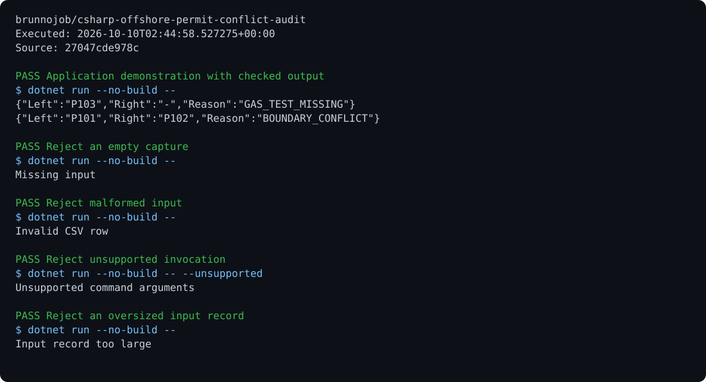

# csharp-offshore-permit-conflict-audit

Detect overlapping work permits with conflicting isolation boundaries and incomplete authorization evidence.

```sh
dotnet run -- --self-test
dotnet run < examples/input.txt
```

Offline engineering analysis. Installation-specific limits and source records determine the result; this program does not operate equipment.

MIT. Built by [brunnodev](https://brunnodev.store).

## Execution proof

[](https://github.com/brunnojob/csharp-offshore-permit-conflict-audit/actions/workflows/proof.yml)



[Verified run](https://github.com/brunnojob/csharp-offshore-permit-conflict-audit/actions/runs/38018083165) · [Execution report](docs/proof/evidence.json)

Run `python .proof/record.py` after installing the prerequisites above. The scenarios execute repository code and verify exit codes and expected output. CI publishes `execution-proof` with the transcript, input fingerprints and source commit. The downloadable report identifies the exact tested version; the workflow badge tracks the latest run.
